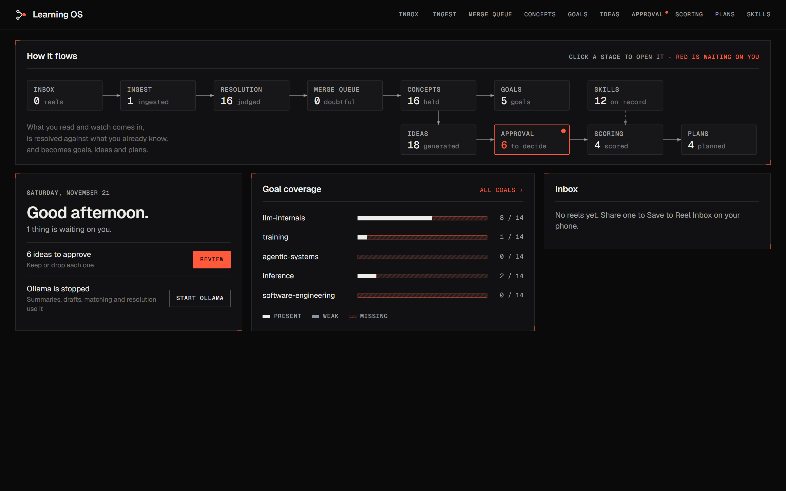
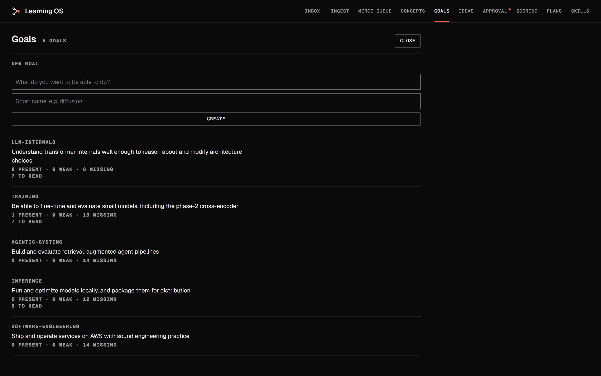
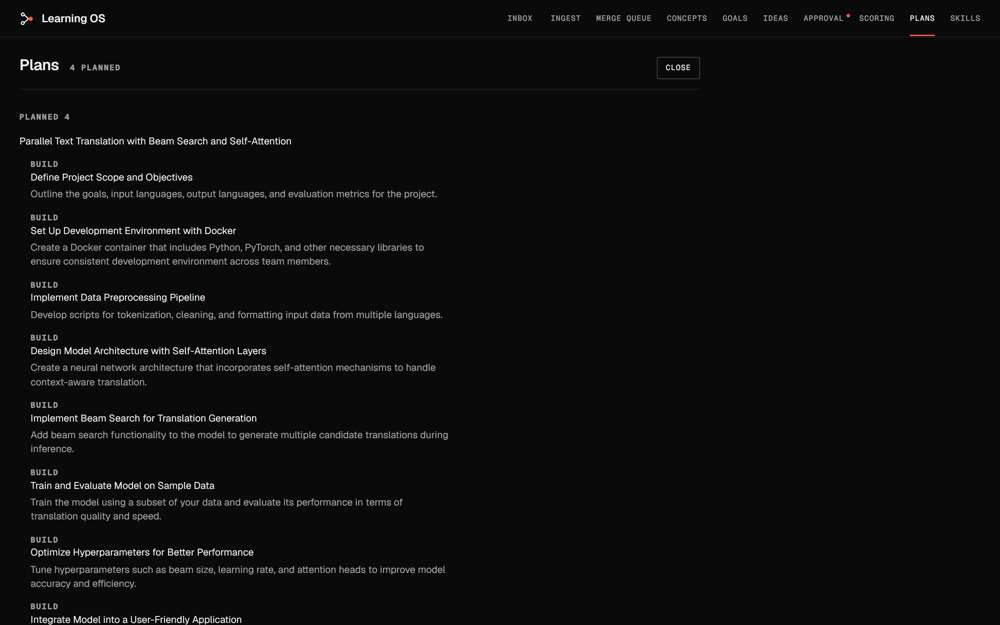

# learning-os

A local-first system that turns what you read into a structured account of what you know, then uses that account to decide what to learn and what to build next.

Everything that reasons runs on your machine: concept extraction, identity resolution, idea generation, feasibility scoring, planning and reel summaries all call a local [Ollama](https://ollama.com) model, and embeddings and speech-to-text are local. Storage is SQLite files plus a ChromaDB directory. Nothing you ingest leaves the machine, with two exceptions: web search for reading recommendations (Tavily), and the Reel Inbox mailbox, which holds a saved reel's link and note in Supabase until the app pulls it.

[MIT licensed](LICENSE). 



## How it works

```
ingest a paper or note → extract candidate concepts → identity resolution
    ├─ confident match → reinforce the existing concept
    ├─ confident new   → insert and embed it
    └─ uncertain       → MERGE QUEUE (you decide)

knowledge base ─┬─► goals → gaps (present / weak / missing) → reading recommendations
                └─► sampled concepts → project ideas → APPROVAL GATE (you decide)
                                         → feasibility vs. your skills → execution plan
```

The core rule: **the system never writes to persistent state when it is uncertain.** A model adjudicates each candidate against its nearest neighbours and returns a decision with a confidence. `match` at ≥ 0.85 reinforces, `new` at ≥ 0.65 inserts, and anything else goes to a human. Every decision is logged next to the human's eventual answer, so the thresholds can later be tuned against real disagreement data.

Goals are measured against the knowledge base: each requirement is present, weak or missing, and the gaps drive what to read next.



An approved idea is scored against your skills and turned into a step-by-step plan.



## Setup

Requires Python 3.11, [uv](https://docs.astral.sh/uv/), and Ollama with `qwen2.5:7b` pulled (and `qwen3:8b` for Reel Inbox summaries).

```bash
ollama pull qwen2.5:7b
ollama pull qwen3:8b
uv sync
uv run alembic upgrade head
```

Copy `.env.example` to `.env`. Only `TAVILY_API_KEY` is needed, and only for reading recommendations.

```bash
uv run pytest -m "not live"   # fast, offline; what CI runs
uv run pytest                 # also runs the live Ollama/Tavily tests (~10 min)
```

## Usage

```bash
uv run python -m web.shell    # desktop app
uv run python -m web.serve    # same panel in a browser at http://127.0.0.1:8765/
```

### Taskbar icon

To open the app from the taskbar with no terminal:

```bash
powershell -ExecutionPolicy Bypass -File desktop\make_shortcut.ps1
```

This writes `Learning OS.lnk` to the project folder and the Start menu. Right-click either one and choose **Pin to taskbar**; Windows doesn't let scripts pin. To open the app at login, put a shortcut to `desktop\start_learning_os.vbs` in the Startup folder (Win+R, `shell:startup`). Run `make_shortcut.ps1` again if the project folder moves.

The home page shows how the pipeline flows, with each stage's count, and marks in red whatever is waiting on you. From it you can manage goals (create, draft requirements with the local model, edit, delete), generate ideas, and work through the merge queue. It also starts and stops Ollama, which most stages need and which the app does not start on its own. Both entry points bind to `127.0.0.1` only. On Windows 10 you need the Edge WebView2 runtime; Windows 11 has it.

### Reel Inbox

Share an Instagram Reel or YouTube Short from your phone to an iOS Shortcut, and it lands in a Supabase mailbox ([setup](reel_inbox/capture/README.md)). Nothing happens on its own after that; in the Inbox:

- **Pull** copies waiting reels from the mailbox into the local store. It never runs the model.
- **Process now** summarizes a small batch of stored reels: captions if the video has them, otherwise speech-to-text with faster-whisper, then two or three sentences from the local model. A run stops early, leaving the rest waiting, on an Instagram login wall or rate limit, or when Ollama is not running.
- **Write it** gives a reel a title and description by hand instead, and **Retry** puts a failed reel back in line.

Every stage, ingestion included, has a panel surface. `cli.py` is intentionally untracked, so a fresh clone has no command-line entry point; for scripted use, call the importable modules directly, for example:

```python
from ingestion.papers import ingest_paper
from storage.db import get_engine, get_session
from storage.vectors import get_chroma_client, get_concepts_collection

engine = get_engine("data/learning_os.db")
collection = get_concepts_collection(get_chroma_client("data/chroma"))
with get_session(engine) as session:
    ingest_paper(session, collection, "https://arxiv.org/abs/1706.03762")
```

## Architecture

One Python package per stage, with no framework or service layer: functions take a `session` and return values, and [LangGraph](https://langchain-ai.github.io/langgraph/) is used only where a stage is a true pipeline.

| Package | Responsibility |
|---|---|
| `storage/` | SQLAlchemy models, SQLite engine, ChromaDB collection |
| `ingestion/` | Paper and note ingestion graphs |
| `resolution/` | Identity resolution and the merge-queue review |
| `goals/` | Requirement drafting and gap classification |
| `recommend/` | Gaps → search → dedup → relevance filter |
| `skills/` | Skills entry |
| `opportunities/` | Idea generation, approval, feasibility scoring, planning |
| `web/` | FastAPI app, job registry, pywebview shell |
| `reel_inbox/` | Reel Inbox, self-contained: phone capture through a Supabase mailbox, manual pull, local summaries (yt-dlp, faster-whisper, Ollama), hand-written entries. Its own SQLite store under `%APPDATA%\LearningOS`. See [its capture setup](reel_inbox/capture/README.md). |

- **Loops are not graphs.** Anything that walks rows and commits per row is a plain loop; a node blocking on `input()` is hard to test and resume.
- **Every model call is injectable** (`match_fn`, `generate_fn`, `plan_fn`, …), so the suite runs without a model apart from a few `@pytest.mark.live` tests.
- **Batch work is resumable.** Each stage selects only unhandled rows and commits per row, so an interrupted run loses nothing.

Data lives in one SQLite database with eight tables (`concepts`, `merge_queue`, `adjudication_log`, `skills`, `goals`, `content_log`, `opportunities`, `recommendations`), migrated with Alembic. List-shaped fields are JSON in TEXT columns. `skills` is the one table only you write to. Reel Inbox keeps its own SQLite file with two tables (`captures`, `extractions`), apart from these migrations so the package can be lifted out unchanged; a column added later is added when the store opens.

## Lessons

- **A JSON schema that permits a degenerate answer will get one.** A bare top-level array schema is satisfied by `[]`; an empty milestone list satisfies `IS NOT NULL`. Wrap, require, and raise on empties.
- **Treat the model's reply as a lookup table, not the list you iterate.** Walk your stored requirements and look each up in the answer, so omissions count as missing and inventions are ignored.
- **Embedding similarity is not a synonym matcher.** `containerization` scored 0.577 against Docker. Goal requirement phrases work only because they are hand-written to be retrievable, and every acronym is spelled out (`"KV cache key-value cache"`).

## Known gaps

- `qwen2.5:7b` is used by every stage except Reel Inbox summaries (`qwen3:8b`); the design calls for 14b, so quality judgments are confounded by model size.
- Prompt adherence is inconsistent in notes extraction, `required_skills` and learn-milestone targeting.
- Nothing is recomputed: learning a skill does not update existing scores or plans.
- Thresholds (`k=5`, 0.85, 0.65, 0.70) were chosen by feel and are unmeasured.
- `skills.last_used` has no writer.
- No installer; running it means cloning the repo and using `uv`.
